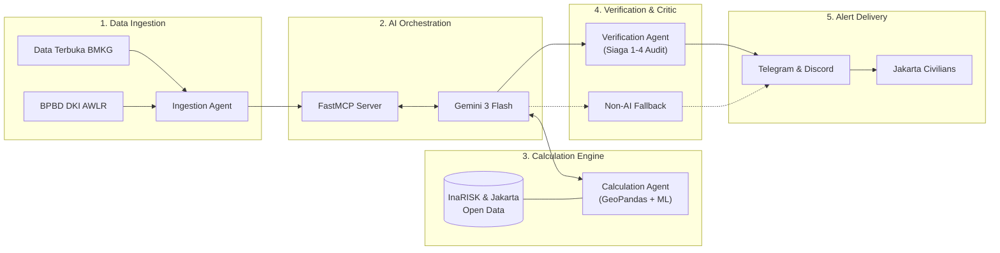

# 🌊 Diluvium
**AI-Integrated Early Warning System for Hydrometeorological Disasters in Jakarta**


## 📖 Overview
**Diluvium** is an automated, intelligent early warning system designed for civilians living in flood-prone areas of DKI Jakarta. Instead of relying on static water-level thresholds or a single monolithic LLM that risks hallucinating numbers, Diluvium uses a **Modular Multi-Agent Pipeline** built on the **Model Context Protocol (MCP)** and **FastMCP**.

The system continuously aggregates real-time rainfall telemetry from **BMKG** and river water levels from **BPBD DKI Jakarta (Pantau Banjir AWLR)**, computes hyper-localized flood arrival times and inundation radii using deterministic & ML models alongside **GeoPandas**, and audits every prediction against Jakarta's official **Siaga 1–4 thresholds** before dispatching verified alerts via **Telegram** and **Discord**.

---

## 🏗️ System Architecture (Helicopter View)



---

## 📂 Project Structure

```text
Diluvium/
├── data/
│   ├── raw/                  # Raw Jakarta Open Data & InaRISK datasets
│   └── processed/            # Cleaned GeoJSON / Parquet spatial caches
├── models/                   # Saved ML model weights (.joblib / .pt)
├── src/
│   ├── config.py             # Environment variables & API configuration
│   ├── schemas.py            # Shared Pydantic data validation contracts
│   ├── mcp_server.py         # Central FastMCP server exposing agent tools
│   ├── ingestion/            # Agent 1: BMKG & BPBD API clients + retry logic
│   ├── calculation/          # Agent 2: GeoPandas spatial susceptibility & ML models
│   ├── verification/         # Agent 3: Siaga 1-4 threshold critic & bot notifiers
│   ├── orchestrator/         # Gemini 3 Flash orchestrator & non-AI fallback script
│   └── gui/                  # Internal Admin/Developer Monitoring Web GUI
├── tests/                    # Unit & End-to-End (E2E) test suites
├── .env.example              # Template for API keys and secrets
├── requirements.txt          # Locked Python dependencies
└── README.md
```

---


---

## 👥 Team & Responsibilities (RPL)
| Member | Role | Owned Epics |
| :--- | :--- | :--- |
| **Radya Gardian Pranoto** | DevOps, FastMCP & QA | *Project & Environment Prep*, *Quality Control & Deployment*, FastMCP Integration (`KAN-20`) |
| **Sutan** | Data Pipeline & AI Infrastructure | *Data Ingestion* (`KAN-12`), *AI Orchestration* |
| **Irgy** | Core Logic & Verification | *Calculation & Integration*, *Verification & Alert System* |